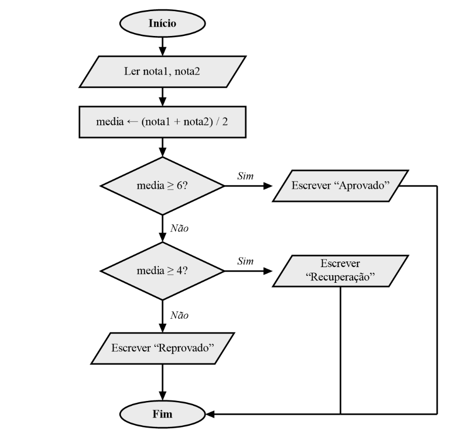

# 🧠 Algoritmos e Lógica de Programação — do projeto à implementação

Trabalho da disciplina de **Algoritmos e Lógica de Programação** na **Fatec Taquaritinga**. Ele apresenta os conceitos da ementa (**representação de algoritmos, seleção, repetição, vetores e registros, rotinas, arquivos e eficiência**) e resolve **seis problemas implementados em Python**.

| Arquivo | Descrição |
|---|---|
| 📄 [`Trabalho_Algoritmos_Logica_Programacao.pdf`](Trabalho_Algoritmos_Logica_Programacao.pdf) | Trabalho completo nas normas ABNT (23 páginas) |
| 📝 [`Trabalho_Algoritmos_Logica_Programacao.docx`](Trabalho_Algoritmos_Logica_Programacao.docx) | Versão editável |
| 🐍 [`01_situacao_aluno.py`](01_situacao_aluno.py) | Seleção: média e situação do aluno |
| 🐍 [`02_soma_1_ate_n.py`](02_soma_1_ate_n.py) | Repetição: soma de 1 até n |
| 🐍 [`03_media_compras_clientes.py`](03_media_compras_clientes.py) | Vetores e registros: compras por cliente |
| 🐍 [`04_matriz_pares.py`](04_matriz_pares.py) | Rotinas: matriz de pares e soma das linhas |
| 🐍 [`05_notas_em_arquivo.py`](05_notas_em_arquivo.py) | Arquivos: gravar e ler notas |

---

## 🗺️ Conceito → problema

| Tópico da ementa | Problema desenvolvido |
|---|---|
| Projeto e representação; seleção | Calcular a média de um aluno e informar sua situação |
| Repetição | Somar todos os números de 1 até um valor informado |
| Vetores e registros | Calcular a média de compras de cada cliente |
| Rotinas | Gerar uma matriz de números pares e somar suas linhas |
| Arquivos | Gravar e ler as notas de uma turma em um arquivo de texto |
| Implementação e eficiência | Comparar a busca sequencial com a busca binária |

---

## ✅ Problemas resolvidos

### 1. Situação do aluno: três representações do mesmo algoritmo

O mesmo algoritmo aparece em **descrição narrativa**, em **fluxograma**, em **pseudocódigo (portugol)** e em **Python**.



| Notas | Média | Saída |
|---|:-:|---|
| 7 e 8 | 7,5 | Aprovado |
| 5 e 4 | 4,5 | Recuperação |
| 2 e 3 | 2,5 | Reprovado |

### 2. Soma de 1 até n e teste de mesa

O primeiro `while` valida a entrada, e o segundo faz a soma. Teste de mesa para **n = 4**:

| Momento | contador <= n? | soma | contador |
|---|---|:-:|:-:|
| Início | — | 0 | 1 |
| Fim da 1ª repetição | 1 <= 4: sim | 1 | 2 |
| Fim da 2ª repetição | 2 <= 4: sim | 3 | 3 |
| Fim da 3ª repetição | 3 <= 4: sim | 6 | 4 |
| Fim da 4ª repetição | 4 <= 4: sim | 10 | 5 |
| Saída do laço | 5 <= 4: não | **10** | 5 |

### 3. Vetor de registros com as compras de cada cliente

Cada cliente é um **registro** (dicionário) com o nome e um **vetor** de 4 compras. Por exemplo, compras de R$ 100, R$ 200, R$ 150 e R$ 50 dão **média de R$ 125,00**.

### 4. Funções para gerar a matriz de pares

```
[2, 4, 6]      → soma 12
[8, 10, 12]    → soma 30
[14, 16, 18]   → soma 48
```

`criar_matriz_pares(linhas, colunas)` devolve a matriz, e `somar_linhas(matriz)` devolve as somas. Cada função faz uma única tarefa e pode ser reaproveitada.

### 5. Notas gravadas em arquivo

O programa grava `notas.txt` com uma linha por aluno (`Ana;8.5`, `Bruno;5.0`, `Carla;7.0`) e depois lê o arquivo. O `with` fecha o arquivo automaticamente.

### 6. Eficiência: busca sequencial × busca binária

| Tamanho do vetor (n) | Sequencial (pior caso) | Binária (pior caso) |
|---:|---:|---:|
| 10 | 10 | 4 |
| 1.000 | 1.000 | 10 |
| 1.000.000 | 1.000.000 | **20** |

A **escolha do algoritmo** pesa mais no desempenho do que a velocidade do computador. A busca binária, porém, exige o vetor **ordenado**.

---

## ▶️ Como executar

Com o **Python 3** instalado:

```bash
python 01_situacao_aluno.py
```

---

## 📚 Referências

- ASCENCIO, A. F. G.; CAMPOS, E. A. V. **Fundamentos da programação de computadores**. Longman, 2007.
- FORBELLONE, A. L. V.; EBERSPÄCHER, H. F. **Lógica de programação**. Prentice Hall, 2005.
- ZIVIANI, N. **Projeto de algoritmos: com implementações em Pascal e C**. 2. ed. Thomson Pioneira, 2004.

---

## 🎓 Informações acadêmicas

| | |
|---|---|
| **Instituição** | Fatec Taquaritinga |
| **Curso** | Análise e Desenvolvimento de Sistemas — 1º semestre |
| **Disciplina** | Algoritmos e Lógica de Programação |
| **Ano** | 2026 |

## 👤 Autor

**Juan Gabriel Pereira Augusto**
GitHub: [@JuanGabrielPereiraAugusto](https://github.com/JuanGabrielPereiraAugusto)
